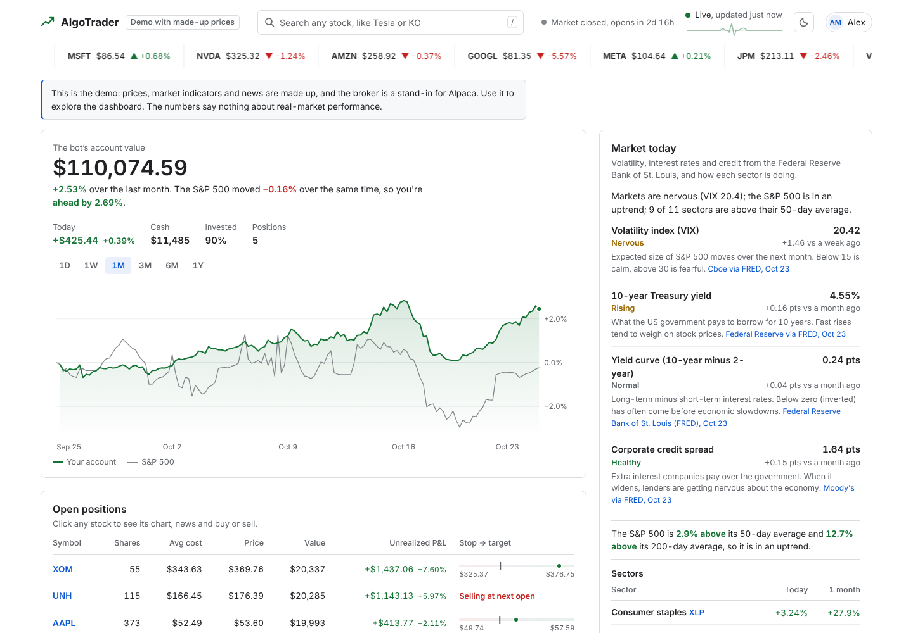

# AlgoTrader

A stock trading bot I built to learn how machine learning, market data and a real broker API fit together.
It trains a random forest on five years of daily prices, paper-trades the signals through Alpaca once a day
after the close, and has a React dashboard for watching what it does.

It only trades paper money. It is a learning project, not investment advice.



## What it does

- Downloads 5 years of split/dividend-adjusted daily bars from Alpaca, cleans them with Pandas and builds
  31 features per stock (returns, moving averages, RSI, MACD, Bollinger bands, ATR, volume, and a few
  S&P 500 features). Optionally adds sector-ETF and FRED macro features (VIX, 10-year yield, yield curve,
  credit spread), but only keeps them if they actually improve the validation score.
- Trains a scikit-learn `RandomForestClassifier` to predict whether a stock gains more than 1% over the
  next 5 sessions. Validation is chronological: purged walk-forward CV on the older 75% of the data, then
  one test on the newest 25%, which is also where the backtest runs.
- Every weekday after the close it scores the stocks, applies the strategy and sends bracket orders
  (5% stop, 10% target) to an Alpaca paper account. The backtest and the live bot call the same
  `decide()` function, so they can't drift apart.
- The dashboard shows the account against the S&P 500 (1D to 1Y), positions, the model's signals,
  market conditions, news, bot runs and the model report. You can search any US stock and buy or sell
  from its panel.
- Other people can sign up, connect their own Alpaca paper account and trade in it. Passwords are scrypt
  hashes and saved API keys are encrypted. Only the admin sees the bot's own account.

**Stack:** Python 3.11+, Pandas, NumPy, scikit-learn, Flask, React 19 (esbuild), SQLite or PostgreSQL
(Supabase), Alpaca API, FRED. Runs locally, in Docker, or on Vercel with a daily cron job.

## Getting started

You'll need Python 3.11 or newer and Node.js 20 or newer.

```bash
cd backend
python -m venv .venv
source .venv/bin/activate        # Windows: .venv\Scripts\activate
pip install -r requirements.txt

cd ../frontend
npm install
npm run build
```

### Try the demo first

No API keys needed:

```bash
cd backend
python -m algotrader demo
```

Then open http://127.0.0.1:8000. The demo makes up a market, trains on it, simulates three months of
trading against a local fake of the Alpaca API, and serves the dashboard with moving prices. The numbers
are synthetic, so don't read anything into them.

### Run it with your own paper account

1. Create a free account at [alpaca.markets](https://alpaca.markets), switch to Paper Trading and
   generate API keys.
2. Copy the example config and fill in the keys (leave `ALPACA_PAPER=true`):
   ```bash
   cp .env.example backend/.env        # Windows: copy .env.example backend\.env
   ```
3. From `backend/`:
   ```bash
   python -m algotrader check          # are the keys OK?
   python -m algotrader train          # download data, train, test, backtest
   python -m algotrader serve          # dashboard on http://127.0.0.1:8000
   python -m algotrader bot            # trades once per trading day at 16:20 New York time
   ```

The first account created on your own machine becomes the admin. On a server, make yourself admin with
`python -m algotrader users make-admin you@example.com`.

To see what the bot would do today without placing orders: `python -m algotrader trade --dry-run --force`.

## Commands

| Command | |
|---|---|
| `check` | Checks the keys, account status and market data access |
| `doctor` | Checks Alpaca, FRED, news, the model, the database and the dashboard, and suggests fixes |
| `fetch` | Downloads the price history and FRED data |
| `train` | Features, model, out-of-sample test and backtest (`--refresh` re-downloads data) |
| `backtest` | Re-runs only the backtest, handy after changing strategy settings (`--json` for raw numbers) |
| `trade` | One trading cycle now (`--dry-run`, `--force`) |
| `bot` | Runs forever, one cycle per trading day (`--now` to also run immediately) |
| `serve` | Dashboard and API |
| `demo` | Offline demo with synthetic data |
| `users ...` | `list`, `make-admin`, `remove-admin`, `reset-password`, `delete` |
| `db ...` | `status`, and `copy-from-sqlite` to move local data into PostgreSQL |

All of them run as `python -m algotrader <command>` from the `backend` folder.

## How it works

```
Alpaca bars ─► data.py ─► features.py ─► model.py ──► backtest.py
FRED, sectors ─► context.py ─┘   (random forest,      (same rules
                                  walk-forward CV)      as live)
                                        │
                     trader.py ◄────────┘  daily cycle ─► Alpaca orders
                         │
                    journal (SQLite / Postgres) ─► api.py (Flask) ─► React dashboard
```

**Strategy.** Buy when the predicted probability is at least 0.58 (best first, up to 5 positions at 18% of
equity each, whole shares). Each buy is a bracket order with a 5% stop-loss and 10% take-profit. Sell when
the probability drops below 0.45 or after 10 sessions. No new buys when SPY is under its 50-day average,
after a 3% down day for the account, or when a stock's recent headlines are clearly negative. All of
these are settings in `.env.example`.

**Backtest.** Event-driven and day by day: orders fill at the next open with 5 bps slippage per side,
stops and targets are checked against each day's high and low, a gap through the stop fills at the open,
and if a stop and target are both hit on the same day it assumes the stop.

**Live trading.** The bot runs after the close so orders queue for the next open, which is the timing the
backtest assumes. Client order IDs are built from the date, symbol and side, so running a cycle twice
doesn't double-buy. Positions you bought yourself are detected from Alpaca's order history and left alone.

**Storage.** Accounts and the bot's journal go in SQLite files by default. Set `DATABASE_URL` to a
PostgreSQL connection string (I use Supabase's Session pooler) and they go there instead, in their own
schema with row-level security turned on.

## Deploying

[DEPLOYMENT.md](DEPLOYMENT.md) covers running it on your own machine, on a small VPS with Docker, on
Render/Railway/Fly, or on Vercel's free plan with Supabase (the bot then runs as a daily Vercel cron job).
It also has a troubleshooting table.

## Tests

```bash
cd backend
pip install -r requirements-dev.txt     # plus `playwright install chromium` for the browser test
python -m unittest discover -s tests -t .

cd ../frontend
npm test
```

There are 215 backend tests and 45 frontend tests. The ones I care most about: features never change when
future bars are appended (no look-ahead), the model scores about 0.5 AUC on pure noise (leak check), the
backtest accounting is checked to the cent, and the whole trading cycle runs against a local fake of the
Alpaca API. 38 of the backend tests run a second time against PostgreSQL when `POSTGRES_TEST_URL` is set.
There's also a headless-browser test that signs up, connects a demo account and buys a stock.

[docs/PROCESS.md](docs/PROCESS.md) has the build notes and the list of bugs the tests caught.

## Project layout

```
backend/algotrader/   Python package: data, features, model, strategy, backtest, trader, api,
                      users and db (accounts/storage), doctor, demo + local fakes for testing
backend/tests/        unittest suite
frontend/src/         React dashboard (App.jsx, components/, lib/)
frontend/tests/       node:test suite
app.py, vercel.json   Vercel entry point and config
Dockerfile, docker/   single-container setup (bot + gunicorn)
```

## A note on results

Whatever the backtest or the paper account shows depends heavily on the period and will change from run
to run. When I tested the pipeline on real GOOG prices from 2004 to 2008 the model had no edge at all
(out-of-sample AUC 0.46). Predicting stock returns is hard, and a good backtest can still fail live.
Use paper trading.
